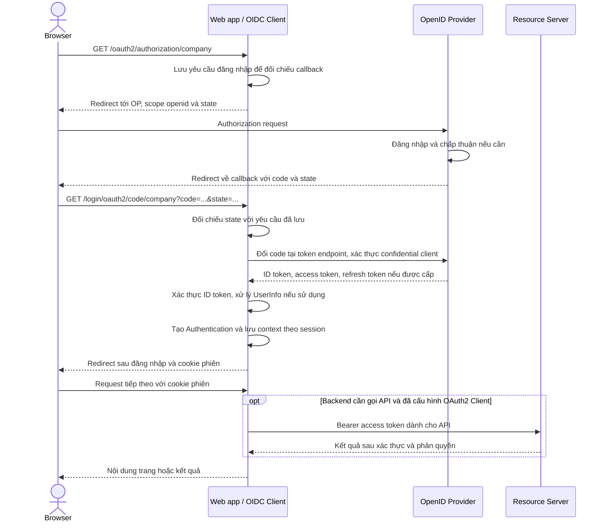
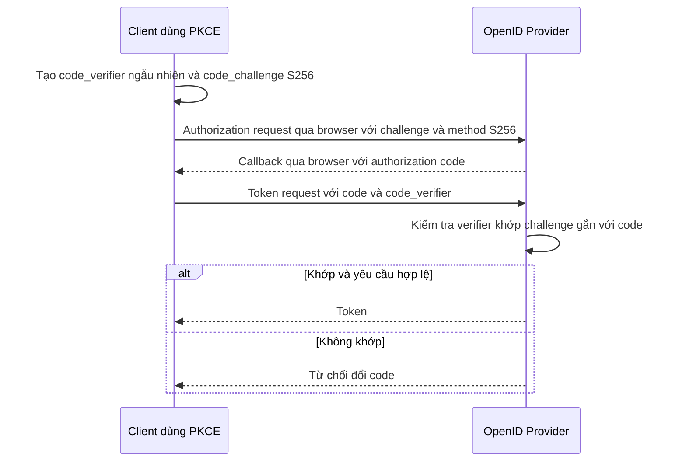
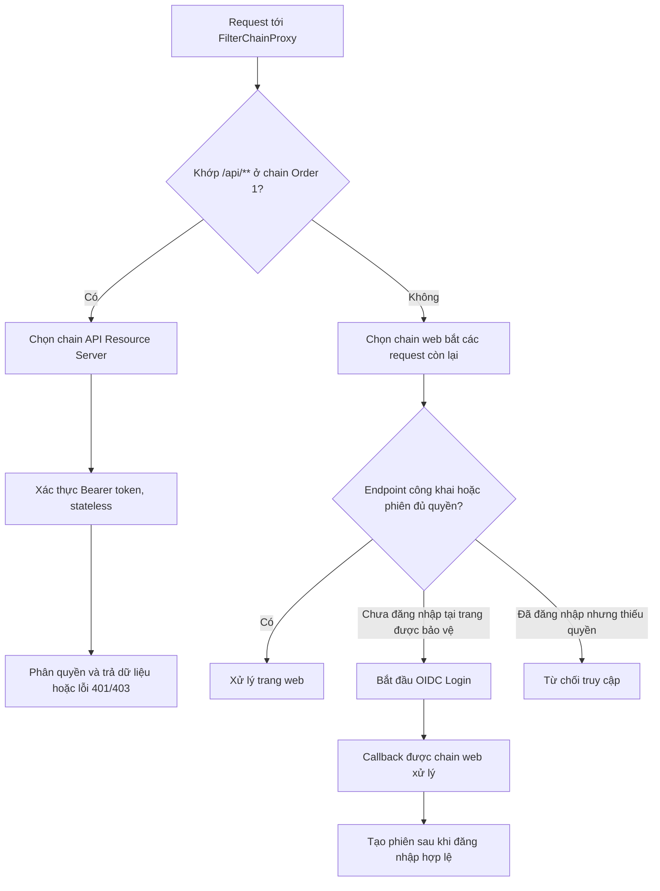

# OpenID Connect (OIDC)

Chi tiết giao thức, ví dụ HTTP và cách kiểm tra PKCE nằm trong [Authorization Code + PKCE](DocumentAuthorizationCodePKCE.md).

Đọc sau [Spring Security](DocumentSpringSecurity.md), [JWT](DocumentJWT.md) và [Resource Server](DocumentResourceServer.md). Tài liệu này tập trung vào đăng nhập và cách kết hợp web với API.

## 1. Các vai trò trong hệ thống

| Thành phần | Trách nhiệm | Ví dụ |
| --- | --- | --- |
| Authorization Server / OpenID Provider (OP) | Xác thực người dùng, cấp token theo giao thức đã cấu hình. | Hệ thống định danh của tổ chức. |
| OAuth2 Client / OIDC Relying Party (RP) | Bắt đầu đăng nhập, nhận callback và đổi code lấy token. | Ứng dụng web Spring Boot. |
| Resource Server | Nhận access token, xác thực token và bảo vệ tài nguyên. | REST API đơn hàng. |
| Resource Owner | Chủ thể cho phép truy cập tài nguyên. | Người dùng. |

Một ứng dụng có thể đảm nhiệm nhiều vai trò. Bật Resource Server không tự tạo trang đăng nhập, endpoint cấp token hay refresh token.

OAuth2 cung cấp cơ chế ủy quyền. OIDC bổ sung lớp danh tính bằng scope `openid` và ID token. JWT chỉ là định dạng token: access token có thể là JWT hoặc opaque token.

## 2. Phân biệt các token

| Token | Bên sử dụng | Mục đích |
| --- | --- | --- |
| Access token | Resource Server | Cho phép gọi API theo audience, scope và chính sách của API. |
| ID token | OIDC Client | Xác nhận kết quả đăng nhập của người dùng với client. |
| Refresh token | Client gửi tới token endpoint | Xin token mới theo chính sách của bên cấp. |

API nghiệp vụ nhận **access token**. Không gửi ID token hoặc refresh token thay access token. `aud` của ID token thường là client ID; `aud` của access token phải phù hợp API nhận nó. Một token có chữ ký hợp lệ chưa đủ để kết luận nó đúng mục đích.

## 3. Logic đăng nhập OIDC

Ví dụ này là web backend giữ token ở server và dùng session cho trình duyệt:

```text
Browser → Web app: /oauth2/authorization/company
Web app → Browser → OP: authorization request, scope có openid
Người dùng đăng nhập tại OP
OP → Browser → Web app: /login/oauth2/code/company?code=...&state=...
Web app → OP token endpoint: đổi code lấy token
Web app: xác thực ID token, xử lý UserInfo nếu sử dụng
Web app: tạo Authentication và lưu context theo session
Browser → Web app: cookie phiên
Web app → Resource Server: Bearer access token (khi cần gọi API)
```

Trong OIDC, client kiểm tra ID token theo giao thức, gồm chữ ký, issuer, audience, thời hạn và nonce nếu đã gửi nonce. `state` liên kết callback với yêu cầu đăng nhập; PKCE liên kết authorization code với bên khởi tạo. Client phải dùng HTTPS và đăng ký chính xác redirect URI. Với public client như SPA/mobile, dùng Authorization Code + PKCE; không nhúng client secret vào frontend.

**Flow Authorization Code trong web backend dùng session:**



Đây là nhánh thành công; callback sai state, đổi code thất bại hoặc ID token không hợp lệ phải dừng đăng nhập. Backend giữ token; browser dùng cookie phiên, không dùng ID token gọi API.

**PKCE bổ sung vào flow như thế nào?**



PKCE không thay thế kiểm tra state, ID token hoặc redirect URI. Public client không có secret; confidential client vẫn xác thực theo phương thức đăng ký. Sơ đồ không khẳng định cấu hình mẫu tự bật PKCE trong mọi phiên bản. Xem [RFC 9700](https://www.rfc-editor.org/rfc/rfc9700.html).

### 3.1 Dependency và client registration

Thêm vào ứng dụng **web đăng nhập**:

```xml
<dependency>
    <groupId>org.springframework.boot</groupId>
    <artifactId>spring-boot-starter-oauth2-client</artifactId>
</dependency>
```

```yaml
spring:
  security:
    oauth2:
      client:
        registration:
          company:
            provider: company
            client-id: ${OIDC_CLIENT_ID}
            client-secret: ${OIDC_CLIENT_SECRET}
            authorization-grant-type: authorization_code
            redirect-uri: "{baseUrl}/login/oauth2/code/{registrationId}"
            scope: openid,profile,email
        provider:
          company:
            issuer-uri: ${OIDC_ISSUER_URI}
```

Đây là confidential web client xác thực bằng secret ở backend. Đăng ký callback, ví dụ `http://localhost:8080/login/oauth2/code/company` cho môi trường học cục bộ, ở OP. Scope truy cập API như `orders.read` cần đăng ký và xin thêm theo chính sách OP; `openid,profile,email` không tự cấp quyền đọc đơn hàng.

### 3.2 SecurityFilterChain cho ứng dụng web

Ví dụ riêng `WebSecurityConfig.java`:

```java
import org.springframework.context.annotation.Bean;
import org.springframework.context.annotation.Configuration;
import org.springframework.security.config.Customizer;
import org.springframework.security.config.annotation.web.builders.HttpSecurity;
import org.springframework.security.web.SecurityFilterChain;

@Configuration
public class WebSecurityConfig {
    @Bean
    SecurityFilterChain webSecurity(HttpSecurity http) throws Exception {
        return http
                .authorizeHttpRequests(auth -> auth
                        .requestMatchers("/", "/error").permitAll()
                        .anyRequest().authenticated())
                .oauth2Login(Customizer.withDefaults())
                .build();
    }
}
```

Giữ session và CSRF cho web dùng cookie. Bắt đầu đăng nhập tại `/oauth2/authorization/company`. Khi thành công, principal OIDC là `OidcUser`; lấy chủ thể qua `getSubject()`. Khi ánh xạ tài khoản nội bộ, dùng cặp `(issuer, sub)` làm định danh liên kết; không mặc định coi email là khóa duy nhất hoặc luôn được xác minh.

`oauth2Login()` xử lý đăng nhập, không tự chuyển tiếp access token tới mọi API. Muốn web backend gọi Resource Server, dùng OAuth2 Client với `OAuth2AuthorizedClientManager` và HTTP client tích hợp phù hợp phiên bản. Refresh token chỉ có khi OP cấp; cấu hình client không bảo đảm luôn nhận được nó.

Logout local xóa phiên của web app; đăng xuất tại OP và thu hồi token là các thao tác riêng, cần cấu hình theo khả năng của OP.

## 4. Khi một ứng dụng vừa có web vừa có API

Cấu hình web ở trên và [cấu hình API Resource Server](DocumentResourceServer.md) là hai ví dụ độc lập. Nếu ghép trong cùng ứng dụng, tạo các `SecurityFilterChain` có thứ tự rõ ràng:

1. Chain `@Order(1)` dùng `securityMatcher("/api/**")`, cấu hình Resource Server, stateless và phản hồi Bearer 401/403.
2. Chain sau cùng bắt các request còn lại, dùng OIDC Login, session và CSRF; chứa cả endpoint bắt đầu đăng nhập và callback.

Chỉ chain đầu tiên khớp request được chạy. `requestMatchers(...)` bên trong `authorizeHttpRequests(...)` xác định quyền trong chain; `securityMatcher(...)` xác định request nào chọn chain. Không sao chép nguyên hai bean không có matcher/thứ tự vào cùng ứng dụng.

**Flow chọn chain khi web và API cùng ứng dụng:**



Đây là cách chọn chain, không phải toàn bộ thứ tự filter trong chain. Endpoint login/callback do filter tương ứng xử lý. Chain web không chạy tiếp sau chain API; API thiếu token không tự động chuyển sang OIDC Login.

## 5. Các tình huống cần kiểm tra khi triển khai

| Tình huống | Kết quả mong đợi |
| --- | --- |
| Truy cập trang web cần đăng nhập | Chuyển hướng vào luồng login. |
| Callback sai state hoặc ID token không hợp lệ | Đăng nhập thất bại. |
| Logout web rồi dùng lại access token còn hạn | Có thể vẫn truy cập API nếu chưa có chính sách thu hồi. |

Đây là tiêu chí kiểm chứng khi triển khai, chưa phải kết quả test của repo tài liệu.


## 6. Nguồn đối chiếu

- [Spring Security: OAuth2 Login](https://docs.spring.io/spring-security/reference/servlet/oauth2/login/core.html): đăng ký client và cấu hình login.
- [OpenID Connect Core 1.0](https://openid.net/specs/openid-connect-core-1_0.html): vai trò ID token và yêu cầu xác thực OIDC.

Tài liệu Spring ở đường dẫn không khóa phiên bản có thể cập nhật. Khi triển khai, đối chiếu lại với phiên bản Spring Boot/Security thực tế của ứng dụng.
